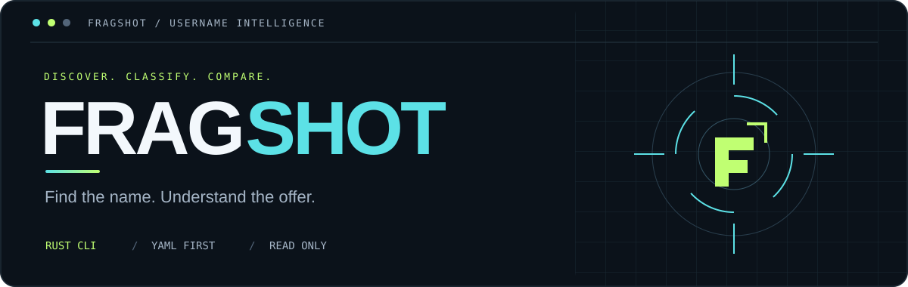

<div align="center">



### Find the name. Understand the offer.

**A colorful Rust CLI for discovering and checking Telegram usernames on Fragment.**  
OG and semi-OG evidence · multilingual dictionaries · exact TON budgets · transparent ratings /10

[](Cargo.toml)
[](fragshot.yaml)
[](#responsible-use)
[](LICENSE)

[Quick start](#quick-start) · [Configuration](#configuration) · [Commands](#command-cookbook) · [Dictionary](#multilingual-dictionary) · [Ratings](#understanding-the-ratings) · [Troubleshooting](#troubleshooting)

</div>

---

> [!IMPORTANT]
> **Research, not trading automation.** FragShot reads public pages. It never connects a wallet, signs a transaction, buys a username, or places a bid. Scores are explainable ranking heuristics—not profit predictions or resale valuations. This project is independent of Telegram and Fragment.

## What you get

| Discover | Understand | Keep |
|:---|:---|:---|
| Bounded auction, sale, and search batches | **OG / SEMI-OG / NON-OG** lexical evidence | One readable **`username.txt`** per selected name |
| Targeted checks by name, file, or dictionary sample | Primary language and semantic category | Language/category folders and a run manifest |
| Budget and manual reserve in exact TON | **Name quality / Price appeal / Interest**, always /10 | Optional structured JSON and spreadsheet-friendly CSV |
| Interest-prioritized detail checks | Separate buy-now, next-bid, and start-bid prices | Sources, timestamps, warnings, and secondary meanings |

The terminal includes an ASCII banner, timestamped logs, colored action badges, budget indicators, and progress. Non-OG noise is hidden by default. Redirected output stays readable with `--color never`.

### A feel for the output

**Illustrative summary using the offline demo's simulated `brain` offer, without corpus-frequency data. Not a screenshot or a live listing.**

```text
FRAGSHOT / USERNAME SCOUT

  OG  @brain                                     BUY NOW
  Primary: Body / English                         8 TON

  Name quality   7.0/10
  Price appeal   8.6/10
  Interest       6.0/10                           Worth reviewing

  Basis: buy_now / simulated
  Heuristic ranking only. No resale or profit forecast.
```

Installed dictionary evidence can change the demo's classifications and scores. The availability and prices remain simulated.

## Quick start

### 1. Get the source and prerequisites

Download this repository using **Code → Download ZIP**, extract it, and open a terminal in the extracted project folder. Alternatively, clone the repository using its actual GitHub URL.

For Windows, install:

- **Current Rust stable** through [rustup](https://rustup.rs/), including Cargo.
- **Visual Studio Build Tools** with **Desktop development with C++** and a Windows SDK for the MSVC toolchain.
- A terminal such as PowerShell or Windows Terminal for the colored interface.

Check the toolchain:

```powershell
rustc --version
cargo --version
```

The first build downloads Rust dependencies. No Telegram account, API key, TON wallet, Node.js, Python, or separately installed SQLite server is required.

### 2. Build the executable

```powershell
.\builder.bat
.\fragshot.exe --version
```

The builder detects your native Rust target, builds with the lockfile, and copies the **actual release executable** to the project root:

```text
FragShot/
├── fragshot.exe       ← launch this on Windows
├── fragshot.yaml      ← default settings
└── builder.bat        ← rebuild after source updates
```

Close any running `fragshot.exe` before rebuilding. A failed compilation does not replace the previous root executable. The source repository does not need to contain a compiled `.exe`; the builder creates it locally.

<details>
<summary><strong>Linux / macOS build commands</strong></summary>

With current Rust stable and your platform's native C/C++ build tools installed:

```sh
cargo build --release --locked
./target/release/fragshot demo --save-results=false
./target/release/fragshot --config fragshot.yaml scan
```

On macOS, install the Xcode command-line tools; on Linux, install your distribution's native build toolchain. SQLite is compiled through the bundled dependency. Windows is the locally verified platform; these are the standard Cargo build/run paths, not a claim of Linux/macOS release testing. Use the Unix executable path instead of `.\fragshot.exe` in the examples below.

</details>

### 3. Try the offline preview

```powershell
.\fragshot.exe demo --save-results=false
```

This makes **zero network requests** and writes no text reports with the default export settings. It uses the embedded lexicon plus any already-installed dictionary. Every offer is marked **SIMULATED**.

To preview the categorized output files too:

```powershell
.\fragshot.exe demo
```

### 4. Set your budget

Open [`fragshot.yaml`](fragshot.yaml). Start with these two settings:

```yaml
budget:
  max_ton: "100"
  reserve_ton: "0"
```

`price + reserve <= max_ton` determines whether an action fits. The reserve is your own allowance, **not an automatic fee calculation**. TON amounts must be quoted strings and support up to nine decimal places.

### 5. Check dictionary coverage

```powershell
.\fragshot.exe dictionary status
```

No installed dictionary? You can still run the app with its small embedded curated lexicon, but live matches will be limited. See [Multilingual dictionary](#multilingual-dictionary) before choosing the optional multi-gigabyte installation. A normal scan never installs it automatically.

### 6. Start small, then use the default profile

```powershell
# Small live sample: at most 2 catalogue batches and 2 detail checks.
.\fragshot.exe scan --batches 2 --details 2 --limit 10

# Run the configured operation: a balanced live scan by default.
.\fragshot.exe
```

The configured scan allows **32 catalogue requests + 30 detail checks**, with **100 displayed results** and **24 dictionary query seeds**. These are caps, not promised results. Allow at least roughly 90 seconds of request spacing for a full default run, plus network and dictionary processing time.

### 7. Inspect the saved results

Open the run directory printed by the app under `results/`. Each selected name gets a text file with its Fragment link, evidence, action prices, scores, and warnings. Always verify the current listing manually before acting.

## Configuration

[`fragshot.yaml`](fragshot.yaml) and [`fragshot.example.yaml`](fragshot.example.yaml) ship with the **same balanced defaults**, aligned with the built-in configuration.

| Setting | Default | Meaning |
|:---|:---|:---|
| `run.mode` | `scan` | Operation used when no CLI command is supplied |
| `budget.max_ton` / `reserve_ton` | `"100"` / `"0"` | Exact maximum and manually chosen reserve |
| `scan.markets` | `[all]` | Auction/sale baseline plus public query searches |
| `scan.sorts` | `[price_asc, recent, ending]` | Catalogue ordering on Fragment |
| `scan.max_catalog_requests` | `32` | Maximum distinct catalogue/search batches |
| `scan.max_detail_requests` | `30` | Maximum individual listing checks |
| `scan.max_results` | `100` | Maximum displayed/saved selected names |
| `scan.dictionary_queries` | `24` | Maximum automatic verified query seeds |
| `ranking.sort` | `interest` | Local ordering after classification and scoring |
| `check.max_names` | `50` | Maximum names requested in check mode |
| `matching.tiers` | `[og, semi_og]` | Non-OG names stay hidden |
| `matching.languages` | `[en, fr, ru, de, es, it, pt]` | Enabled lexical languages, not UI languages |
| `matching.include_offensive` | `true` | Preserve descriptive offensive labels; set `false` to exclude |
| `dictionary.frequency_urls` | `[]` | Optional corpus sources; no extra downloads by default |
| `network.delay_ms` / `timeout_seconds` | `1500` / `20` | Sequential request spacing and per-request timeout |
| `results.enabled` / `grouping` | `true` / `[language, category]` | Categorized text reports |

### Precedence and paths

1. An explicit `--config path.yaml` selects that file.
2. Otherwise, `fragshot.yaml` in the working directory wins, followed by one beside the executable.
3. With no configuration file, built-in defaults apply.
4. Explicit CLI options override the selected configuration; a CLI subcommand overrides `run.mode`.

Relative **YAML paths** resolve beside that YAML file. Explicit **CLI paths** resolve from the working directory. Create a personal copy named `personal.local.yaml` if you want a separate profile; root `*.local.yaml` files are ignored by Git and are **not automatically loaded**:

```powershell
.\fragshot.exe --config personal.local.yaml
```

Supported YAML modes: `scan`, `check`, `demo`, `dictionary_sync`, `dictionary_import`, and `dictionary_status`. For import mode, set `dictionary.input`. For check mode, supply `check.names`, `check.file`, or `check.dictionary`.

> [!TIP]
> YAML enum values use **underscores** (`price_asc`, `name_quality`, `start_auction`). Corresponding CLI enum values use **hyphens** (`price-asc`, `name-quality`, `start-auction`). Category tokens such as `first_name` keep their underscores in both.

<details>
<summary><strong>Example: a focused first-name and space profile</strong></summary>

Merge these sections into your YAML; retain the other defaults:

```yaml
budget:
  max_ton: "50"
  reserve_ton: "1"
matching:
  tiers: [og]
  languages: [en]
  categories: [first_name, space]
  include_offensive: false
scan:
  max_catalog_requests: 16
  max_detail_requests: 10
  max_results: 30
ranking:
  sort: interest
```

Multiple categories use OR matching. Tier, language, and category must match the same eligible lexical analysis. Unspecified-language curated entries remain eligible as a fallback; they are not relabeled English. Any recorded offensive meaning excludes a name when `include_offensive` is false, even if its primary meaning is ordinary.

</details>

<details>
<summary><strong>Legacy TOML compatibility</strong></summary>

YAML is the complete configuration format. Older TOML is supported only when explicitly selected:

```powershell
.\fragshot.exe --config fragshot.example.toml demo
```

Use [`fragshot.example.toml`](fragshot.example.toml) for legacy syntax, not as the full current settings reference. Prefer YAML for dictionary, scanning, matching, console, and result configuration.

</details>

## Command cookbook

All live commands below perform public **read-only** requests. Start with modest limits.

### Discover offers

```powershell
# Fixed-price listings under 50 TON, ordered locally by interest.
.\fragshot.exe scan --market sale --status sale --max-ton 50 --rank-by interest

# Auction sample, with a strict request cap and cheapest-action output order.
.\fragshot.exe scan --market auction --batches 6 --details 5 --limit 20 --rank-by price-asc

# Targeted public search; explicit --query disables unrelated automatic seeds.
.\fragshot.exe scan --query brain --batches 3 --details 3

# Verified OG only, with requested semantic categories.
.\fragshot.exe scan --og-only --language en --category first_name,space,animal
```

`--sort` changes Fragment's catalogue order. `--rank-by` changes your final local result order. They are separate controls.

### Check specific usernames

```powershell
# Matching names remain visible even over budget or without an offer.
.\fragshot.exe check brain brainer alice --max-ton 100

# UTF-8 text file: one username per line, optional @, # comments allowed.
.\fragshot.exe check --file usernames.example.txt --limit 10

# Bounded dictionary sample, NOT a check of every dictionary entry.
.\fragshot.exe check --dictionary --limit 20

# Diagnose an unrecognized name that would otherwise be hidden.
.\fragshot.exe check unknownsample --show-non-og
```

Checks still apply lexical, length, and status filters. `--show-non-og` permits unknown lexical names; `--show-unavailable` is a different control for marketplace availability. A check's `--limit` caps requested names, while a scan's `--limit` caps displayed results. `--details` applies only to scans.

### Export, sort, and control presentation

```powershell
# Local name-quality ranking, without text report files.
.\fragshot.exe demo --rank-by name-quality --save-results=false

# Plain console output for terminals or logs without ANSI support.
.\fragshot.exe demo --color never --save-results=false

# Explicit simulated JSON/CSV exports; choose unused filenames each time.
.\fragshot.exe demo --json demo-results.json --csv demo-results.csv

# Discover all options and valid CLI enum values.
.\fragshot.exe --help
.\fragshot.exe scan --help
.\fragshot.exe check --help
.\fragshot.exe dictionary --help
```

`--save-results=false` disables per-name text reports, **not separately configured JSON/CSV exports**. Set `results.json` and `results.csv` to `null` if you want no exports. Boolean flags use `=false` when explicitly disabled. Color mode accepts `auto`, `always`, or `never`; automatic mode respects `NO_COLOR`.

## Multilingual dictionary

### Two levels of coverage

| Embedded curated lexicon | Optional installed index |
|:---|:---|
| Ready immediately; no download | Streamed Kaikki/Wiktextract data into local SQLite |
| Small selection of words, names, brands, games, and cities | Much broader language and lexical coverage |
| Clearly reported as **CURATED FALLBACK ONLY** | Actual coverage reported by `dictionary status` |
| Good for demos and focused checks | Recommended for broader discovery |

**Interface, code comments, diagnostics, and documentation are English. Dictionary spellings remain multilingual by design.** Language comes from each entry's `lang_code`, not an ASCII spelling or the language of the source website. Original spelling and transliteration evidence are retained; conflicting meanings stay separate.

### Install explicitly

```powershell
.\fragshot.exe dictionary sync
.\fragshot.exe dictionary status
```

> [!WARNING]
> **This is a large operation.** The source advertised approximately 2.9 GB compressed / 24.8 GB decompressed when checked on 2026-11-18; the rolling upstream file can change. Allow substantial time, bandwidth, and free disk space for the new SQLite index alongside any previous one. Limiting languages reduces indexed data, but the shared raw source still has to be downloaded and streamed.

Defaults cap compressed input at 4 GiB, decompressed input at 40 GiB, and each record at 4 MiB. The importer streams records rather than holding the source in memory. A completed new index is activated only after success. Ctrl+C cancels an import without replacing the previous active index.

To import a file you already downloaded:

```powershell
.\fragshot.exe dictionary import "C:\Dictionaries\raw-wiktextract-data.jsonl.gz"
```

Both JSONL and JSONL.gz are supported. Select languages in `matching.languages` **before importing**. Enabling a new language later does not automatically install its entries; an explicit import/sync is needed for missing coverage. Normal scans only reuse the existing index.

### Optional commonness rankings

Frequency data improves the name-quality commonness component, but **does not prove that a word exists or has a particular meaning**. The public defaults leave `frequency_urls` empty. Before your next explicit sync/import, you can opt into these compact sources:

<details>
<summary><strong>Seven-language FrequencyWords configuration</strong></summary>

Replace `dictionary.frequency_urls: []` with the following list inside the existing `dictionary` section:

```yaml
frequency_urls:
  - https://raw.githubusercontent.com/hermitdave/FrequencyWords/master/content/2018/en/en_50k.txt
  - https://raw.githubusercontent.com/hermitdave/FrequencyWords/master/content/2018/fr/fr_50k.txt
  - https://raw.githubusercontent.com/hermitdave/FrequencyWords/master/content/2018/ru/ru_50k.txt
  - https://raw.githubusercontent.com/hermitdave/FrequencyWords/master/content/2018/de/de_50k.txt
  - https://raw.githubusercontent.com/hermitdave/FrequencyWords/master/content/2018/es/es_50k.txt
  - https://raw.githubusercontent.com/hermitdave/FrequencyWords/master/content/2018/it/it_50k.txt
  - https://raw.githubusercontent.com/hermitdave/FrequencyWords/master/content/2018/pt/pt_50k.txt
```

Each configured URL is fetched during an explicit import, but frequency updates only affect existing entries of that language. Keep the list aligned with your enabled languages to avoid unnecessary downloads. These URLs are rolling upstream resources, not pinned snapshots. Sources and licenses are recorded in [data/THIRD_PARTY.md](data/THIRD_PARTY.md) and [data/sources.json](data/sources.json). An import with frequency URLs can access the network even when the main dictionary input is a local file; use an empty list for a fully local import.

Changing this list does not modify the already-installed database. Existing frequency ranks remain usable until a subsequent import replaces the index. Runtime ranking loads at most 50,000 positive-frequency names per enabled language, not the whole dictionary.

</details>

One recorded full import produced **2,831,243 unique normalized names and 3,361,360 analyses** across seven languages. Treat that figure as an example of source scale, not bundled data or a promise about your machine. Entries include forms and transliterations, not only independent OG lemmas. Coverage varies by category; company labels are particularly sparse. Use `dictionary status` to inspect your installed index.

## Lexical tiers and categories

| Tier | What it means | Example |
|:---|:---|:---|
| **OG** | Curated or independently evidenced lemma/proper-name entry | `brain` |
| **SEMI-OG** | Verified source form, or conservative derivation from a verified root | `brainer` → `brain` |
| **NON-OG** | Unrecognized text, arbitrary decorations, or unsupported lexical evidence | Hidden by default |

OG is a **lexical classification**, not a promise of rarity, desirability, ownership rights, or resale demand. An OG name can be unavailable; an unrecognized name can still be for sale.

**Available category tokens:**

| People and identity | Places and culture | Meaning and themes |
|:---|:---|:---|
| `first_name`, `surname` | `city`, `video_game` | `word`, `food`, `animal`, `nature` |
| `brand`, `company` | `slang`, `profanity` | `space`, `technology`, `science`, `body` |
| | | `color`, `time`, `unknown` |

The primary category and language come from one coherent analysis. The console, JSON, and report folder use that same choice. Secondary meanings remain in the report. A small editorial semantic overlay enriches recognized words—such as `brain` → Body and `moon` → Space—without turning unknown text into a dictionary word.

<details>
<summary><strong>Correct local evidence with YAML overrides</strong></summary>

Merge into the existing `matching` section:

```yaml
overrides:
  brain:
    tier: og
    language: en
    categories: [body, word]
  brainer:
    tier: semi_og
    base: brain
    language: en
    categories: [word]
```

Use lowercase username keys without `@`. Semi-OG entries require a verified base. Overrides are local editorial assertions, not independent market evidence. For simple extra curated names, point `lexicon` at a two-column TSV such as [data/extra.example.tsv](data/extra.example.tsv); fields must be separated by a real tab. TSV entries without language evidence are not automatically labeled English.

</details>

## Understanding the ratings

Every selected name receives **three one-decimal scores out of 10**:

| Score | Question it helps answer | What it does not claim |
|:---|:---|:---|
| **Name quality** | How strong is the lexical, length, spelling, and commonness evidence? | Guaranteed demand or rarity |
| **Price appeal** | How low is the action price relative to your configured quality-adjusted anchor? | Fair market value |
| **Interest** | How compelling is the combination of name quality and price appeal? | Profit, ROI, or future resale price |

Default anchors are **100 TON for OG** and **25 TON for semi-OG** under `scoring`. They are independent of your budget: raising `budget.max_ton` changes eligibility, not a listing's score.

- Buy-now, next-bid, and start-bid actions are scored **separately**.
- **Buy-now is the primary basis when present**, even if only the cheaper bid fits your budget.
- Next-bid/start-bid interest is **provisional and capped at 6.0/10**. The final auction price is unknown.
- Missing, zero, expired, unavailable, and historical prices are not bargains. With no usable action, price/interest display `0.0/10` with `assessable: false`; the name score remains meaningful.
- Missing corpus data means **commonness unknown**, not proof of low demand. Brand/company meanings carry a rights-risk warning, not a bonus.

Labels: **High interest** ≥ 7.0, **Worth reviewing** ≥ 4.0, **Low interest** below 4.0, or **Not assessable** without a valid action.

<details>
<summary><strong>The transparent interest-v1 formula</strong></summary>

Name quality is additive, capped at 10:

| Component | Points |
|:---|:---|
| OG / semi-OG evidence | +4.0 / +2.5 |
| Length 3–5 / 6–8 / 9–12 characters | +2.0 / +1.5 / +0.5 |
| Language frequency rank ≤1,000 / ≤10,000 / ≤50,000 | +3.0 / +2.0 / +1.0 |
| Clean exact alphabetic spelling / disclosed non-exact normalization | +1.0 / +0.5 |

A verified-root rank receives half commonness credit when direct rank is unavailable. Non-OG diagnostics are capped at 2.0. Contributions and warnings are saved with each rating.

For name quality `N` out of 10, anchor `A`, and action price `P`:

```text
R = A × (N / 10)²
Price appeal = 10 × R / (R + P)
Interest = N × Price appeal / 10
```

Implementation uses integer tenths for scores, exact nanoTON for prices, and widened integer intermediates. Price appeal is rounded before interest is calculated. A price score of 5.0 means `P = R`, **not** that the offer is fairly valued. The model, anchors, adjusted reference, action basis, reasons, and warnings are exported for inspection.

</details>

## Marketplace statuses

| Console badge | Meaning |
|:---|:---|
| **BUY NOW** | Confirmed fixed-price purchase action |
| **START AUCTION** | Page explicitly offers an auction-start action and starting amount |
| **BID** | Active auction with a known minimum next bid |
| **OUTBID** | Active auction with a confirmed previous positive bid; not a claim that you bid |
| **BID + BUY NOW** | Separate bidding and immediate-purchase actions |
| **SOLD / UNAVAILABLE / UNKNOWN** | No confirmed usable acquisition action |

Previous highest bids are history, not purchase prices. Catalogue-only observations need detail confirmation. Even a detail-observed price is a point-in-time observation that can change. All actions happen manually on Fragment, outside this application.

## Reports and exports

Illustrative directory structure; actual names and folders depend on the selected run:

```text
results/
└── scan-<timestamp>-<unique-id>/
    ├── run.json
    ├── English/
    │   ├── Body/
    │   │   └── brain.txt
    │   └── FirstName/
    │       └── alice.txt
    └── Unspecified/
        └── Brand/
            └── nike.txt
```

Each text report includes the link, status, primary category/language, all lexical analyses, original spelling and source, exact prices, budget markers, /10 ratings, model/anchors, UTC observation time, and relevant warnings. JSON retains structured evidence; CSV includes primary classifications, score columns, and serialized rating details.

- Run directories are unique; files are created without overwriting existing results.
- One canonical report is saved per selected username, with secondary meanings inside.
- Saved text strips terminal controls and bidi overrides. Windows reserved filenames are escaped.
- `INCOMPLETE.txt` means writing the report set did not finish.
- `run.json` with `complete: false` means scanning stopped early, even if saving the partial reports succeeded. Read `error` before trusting the run.
- Standalone JSON/CSV export parents must already exist. Existing export files are rejected rather than overwritten.

## Discovery limits and responsible defaults

FragShot samples **distinct market/sort/query combinations**. It does not pretend these are numbered pages. The inspected public catalogue exposed no usable next-page cursor, so the app does not fabricate `page=` or `offset_id=` parameters or promise exhaustive market coverage.

Baseline views come first, followed by diversified verified dictionary seeds. The queue is deduplicated and capped. Explicit CLI `--query` keeps a run targeted by disabling automatic seeds. Detail requests prioritize eligible high-interest candidates; a detail response replaces the catalogue observation and recomputes its scores.

Selection counters explain the outcome:

```text
Examined = lexical-filtered + status-filtered + no-price + over-budget + eligible
Eligible = displayed + omitted-by-limit
```

The scan cap, detail cap, and display cap are different. Raising `--limit` cannot create more observations, and raising `--batches` cannot create useful combinations if the available seeds/views are exhausted. **Zero results is an honest outcome**, not a reason to bypass a budget or invent availability.

## Troubleshooting

| Symptom | What to check |
|:---|:---|
| `cargo` or `rustc` not found | Install Rust through rustup and reopen the terminal. The Windows builder also checks Rustup's default installation directory. |
| MSVC linker / Windows SDK error | Install the C++ desktop build tools and Windows SDK, then rebuild. |
| Cannot copy `fragshot.exe` | Close the running executable and verify write access to the project folder. |
| Double-clicked window disappears | Run from PowerShell: `.\fragshot.exe`, so errors and output remain visible. |
| Few or zero matches | Run `dictionary status`; review lexical/status/budget counters. Install the optional dictionary if appropriate, broaden categories/languages deliberately, or use targeted checks. |
| A specific name is hidden | Checks still apply filters. Use `--show-non-og` for unknown lexical names and inspect length/status/category settings. |
| Many results omitted | Increase `--limit` if you want more already-eligible names. This does not increase HTTP coverage. |
| `commonness unknown` | Optional frequency sources were not installed or the entry lacks a rank. This is disclosed uncertainty, not an error. |
| Start-auction offers are missing | Try `check` or `scan --query`; auction/sale baseline views do not enumerate every eligible name. |
| Invalid YAML / quoted TON error | Use spaces, supported keys, quoted amounts, and snake_case YAML enum values. Compare with the example YAML. |
| A path resolves unexpectedly | YAML paths are relative to the YAML file; CLI paths are relative to the working directory. |
| JSON/CSV already exists | Choose a new filename. The app intentionally refuses overwrites. |
| HTTP 403 / 429 / challenge page | Stop. Respect the site's rules; retry later only if permitted, with a larger delay when rate-limited. No bypass is provided. |
| Catalogue not recognized | Fragment's HTML may have changed. Treat the run as incomplete; do not infer availability from an unrecognized page. |
| Scan or dictionary startup is slow | Requests are sequential and paced. Large installed indexes also take time to prepare bounded frequency rankings. |
| Dictionary sync exceeds limits / fails | Check disk, bandwidth, the rolling source size, and the reported error. The previous active index remains intact; do not disable safeguards blindly. |
| Unexpected category or language | Inspect all analyses and provenance. Use a documented local override if you have evidence. Some older imports need an explicit reimport to recover newly supported category metadata. |

## Development

```powershell
cargo test --locked
cargo fmt --check
cargo clippy --locked --all-targets -- -D warnings
.\builder.bat
```

Tests cover exact money arithmetic, parsing/action validity, configuration precedence, lexical evidence, streamed imports, bounded discovery, scoring, safe reports, offline CLI behavior, and the Windows builder.

```text
src/                    CLI, configuration, parsing, classification, scoring, reports
tests/                  Integration and regression tests
data/lexicon.tsv        Embedded curated lexical data
data/semantics.tsv      Evidence-backed editorial category overlay
data/THIRD_PARTY.md     Dictionary and frequency attribution
docs/assets/            README artwork
fragshot.yaml           Balanced public defaults
fragshot.example.yaml   Matching reference configuration
builder.bat             Native Windows release builder
```

Keep code, identifiers, comments, errors, documentation, and configuration guidance **in English**. Multilingual lexical records and rejection-test input strings are data, not translated UI. Add a regression test for behavior changes and keep the read-only, exact-price, bounded-request guarantees intact.

### Before putting your copy on GitHub

Commit the source, tests, `Cargo.lock`, docs, and public default configuration. The included `.gitignore` excludes build outputs, the root executable, `results/`, installed `data/dictionary/`, `data/imports/`, and root `*.local.yaml` personal profiles. Review staged files: do not upload a multi-gigabyte index, private username lists, personal exports, or credentials. Files manually uploaded through a browser are not protected by `.gitignore`.

The banner is stored locally, so the README has no external image dependency.

## Responsible use

- Public HTTPS requests only, with robots checks and sequential pacing.
- Default 1,500 ms spacing; configurable minimum 1,000 ms. No aggressive parallel scraping.
- Bounded response bodies and same-host HTTPS redirects for Fragment requests.
- Stop on denied access, rate limits, HTTP errors, or recognized challenge pages. Known explicit empty search results are handled as empty batches.
- No wallet, authentication session, private API access, proxy rotation, CAPTCHA bypass, bids, or purchases.
- Respect Fragment's terms, applicable rules, and other parties' trademark/name rights. No dataset or score establishes ownership rights, future availability, or profitability.

## License and credits

Application code: **[MIT](LICENSE)**. Imported dictionary and frequency data retain their own licenses and attribution requirements; see **[data/THIRD_PARTY.md](data/THIRD_PARTY.md)** before redistribution.

Built with Rust and public lexical resources from Wiktionary contributors, Kaikki/Wiktextract, and optional FrequencyWords / OPUS data. All marketplace observations remain point-in-time and independently verifiable on [Fragment](https://fragment.com).

---

<div align="center">

**Discover deliberately. Read the evidence. Verify the offer.**

[Back to top](#find-the-name-understand-the-offer)

</div>
